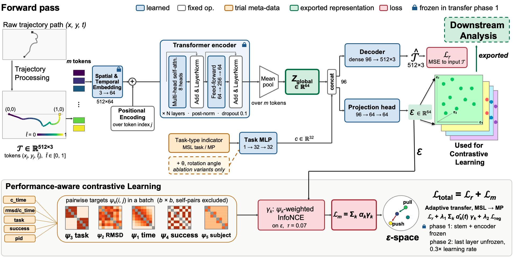

# SMT-Learner: Spatiotemporal Movement Trajectory Learning for Decoding Motor Control and Learning Dynamics in Rehabilitation

[](https://www.python.org/downloads/)
[](https://pytorch.org/)
[](https://www.mathworks.com/products/matlab.html)
[](https://opensource.org/licenses/MIT)
[](https://huggingface.co/raihan116/SMT-Learner)

## Overview

SMT-Learner is a transformer autoencoder that learns representations of spatiotemporal
movement trajectories (SMT) recorded during gamified iPad motor assessments. It combines
movement performance-aware contrastive learning with post-training adaptive transfer that
merges cross-task and cross-subject transfer. The learned embeddings support the
exploration-exploitation (E-E) ratio, a biomarker of motor skill learning and
rehabilitation progress.



## Quick start


#### Requirements

```
torch>=2.0.0
numpy>=1.21.0
pandas>=1.3.0
scikit-learn>=1.0.0
matplotlib>=3.5.0
seaborn>=0.11.0
scipy>=1.7.0
tqdm>=4.62.0
huggingface_hub>=0.20.0
```


```bash
cd SMT-Learner
conda create -n smtlearner python=3.8
conda activate smtlearner
pip install -r requirements.txt
```

```python
import torch
from SMTLearner.TransformerEncoder import SMTLearnerTransformer
from SMTLearner.ContrastiveLossFunctions import MultiTemporalLoss
from SMTLearner.TrainSMTLearner import train_smtlearner_model

model = SMTLearnerTransformer(
    seq_len=512,
    input_dim=3,      # x, y, t
    hidden_dim=64,
    nhead=8,
    num_layers=2,
)

loss_fn = MultiTemporalLoss(within_subject_weight=0.7)

model, optimizer, history = train_smtlearner_model(
    train_df,
    loss_fn=loss_fn,
    hidden_dim=64,
    epochs=50,
)
```

### Transfer learning

```python
from SMTLearner.TransferLearning.SMTLearnerTransferLearning import SMTLearnerTransferLearningRunner

runner = SMTLearnerTransferLearningRunner("path/to/source/model")

# cross-task transfer with progressive unfreezing
ct_model, ct_history, ct_results = runner.run_cross_task_transfer(target_df, epochs=15)

# all four reported paradigms
results, histories = runner.run_comprehensive_transfer_study(target_df)
```

### Reproducing the experiments

```bash
python RunSMTLearnerTraining.py          # pre-train on MSL
python RunSMTLearnerTransferLearning.py  # adaptive transfer to MP
python RunTransferStudy.py --D1 <MSL.csv> --D2 <MP.csv>   # EXP1-EXP4
python RunBaselineComparison.py          # Suppl. TABLE III, baseline block
python RunAblationStudy.py               # Suppl. TABLE III, ablation blocks
```

## Datasets

Trajectory data with 2D coordinates (x, y) and timestamps (t), task metadata (task type,
success, RMSD, completion time), participant identifiers, and performance measures.

- **MSL - Motor Skill Learning.** 
  S. Nemanich, R. Mia, and C. Kemmel-Bartletti, *Motor skill learning in young children
  born preterm*, Jan. 2026.
  DOI: [10.17605/OSF.IO/W4R2F](https://doi.org/10.17605/OSF.IO/W4R2F) ·
  [osf.io/w4r2f](https://osf.io/w4r2f/overview?view_only=c0edc4ed925d4fb6999b313c1c87d352)
- **MP - Motor Performance.**
  C. Kemmel-Bartletti and S. Nemanich, *Game-based mobile-health quantification of
  upper-limb motor performance in children with hemiparetic cerebral palsy*, Jun. 2025.
  DOI: [10.17605/OSF.IO/74DJM](https://doi.org/10.17605/OSF.IO/74DJM) ·
  [osf.io/74djm](https://osf.io/74djm/overview?view_only=e593b1a770264283ba68b892391bbda8)


## Evaluation Metrics

- **Trajectory reconstruction quality:** reconstruction mean squared error (rMSE),
  mean endpoint error (Ep-Err), mean curvature error (Curve-Err).
- **Correlation with movement performance:** completion time (T-Corr), root mean square
  deviation from the optimal path (R-Corr), success reaching the target (S-Corr).

## Pretrained model

The fine-tuned EXP4 adaptive-transfer checkpoint (260,704 parameters, 1.19 MB) is released
at [raihan116/SMT-Learner](https://huggingface.co/raihan116/SMT-Learner). On a single CPU
thread it embeds one trial in 14.4 ms and performs an incremental E-E update in 0.042 ms.

```python
from HuggingFace.Inference import SMTLearnerInference

smt = SMTLearnerInference.from_pretrained("raihan116/SMT-Learner")
embeddings = smt.embed_trials(paths, time_diff_ms)     # (n_trials, 64)
ee_ratio = smt.exploration_exploitation(embeddings)    # (n_trials,)
```

To package and publish a checkpoint:

```bash
python HuggingFace/ExportModel.py --checkpoint <trained.pt> --out HuggingFace/upload
python HuggingFace/ExportModel.py --checkpoint <trained.pt> --out HuggingFace/upload --push
```

The export refuses any checkpoint that does not match the reported architecture, so the
Hub release cannot drift from the manuscript.

## Repository layout

```
SMTLearner/               model, losses, evaluation, transfer learning
DataProcessing/           normalization, preprocessing, dataset combining
E-E_Analysis/             E-E estimation, RQ1-RQ3, clinical validation, case study, sensitivity
HuggingFace/              model packaging, model card, and inference
MATLAB_Scripts/           raw trajectory dataset construction
saved_models/             reported baseline, ablation, and transfer results
```


## Citation

```bibtex
@article{mia2026smtlearner,
  title   = {A Deep Learning Framework for Assessing Pediatric Upper-limb Motor
             Control and Gamified Mobile Rehabilitation},
  author  = {Mia, Md Raihan and Ahamed, Sheikh Iqbal and Nemanich, Samuel},
  journal = {IEEE Transactions on Neural Systems and Rehabilitation Engineering},
  year    = {2026}
}
```
